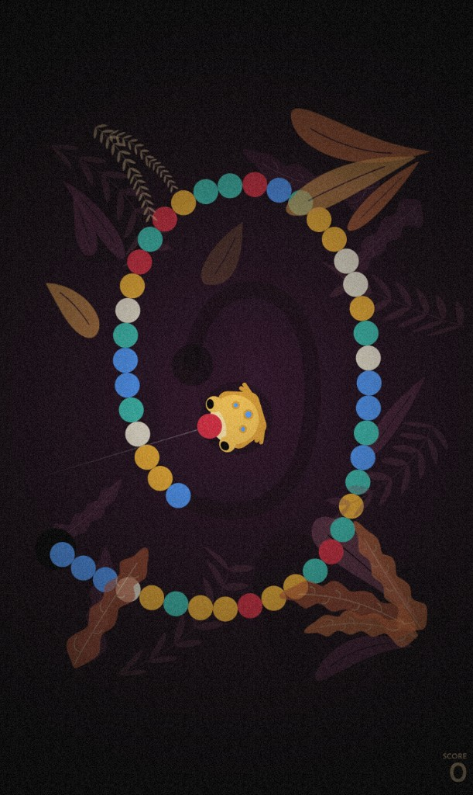

# Amber Frog

A Zuma-style marble shooter built with TypeScript, SCSS, and Vite. Aim the frog, shoot matching colors, and clear the spiral before marbles reach the end.

**Play online:** [jemshithjemc.github.io/Amber-Frog](https://jemshithjemc.github.io/Amber-Frog/)



## Controls

**Mouse / keyboard**

| Action | Input |
| --- | --- |
| Shoot | Left click |
| Switch marble color | `Space` |
| Pause | `Esc` |

**Touch**

| Action | Input |
| --- | --- |
| Shoot | Tap |
| Switch marble color | Tap the frog |
| Pause | Tap `II` |

## Getting started

```bash
npm install
npm run dev
```

Open the URL Vite prints (usually `http://localhost:5173`).

### Scripts

| Command | Description |
| --- | --- |
| `npm run dev` | Start the local dev server |
| `npm run build` | Type-check and build for production |
| `npm run preview` | Preview the production build |

## Stack

- TypeScript
- SCSS
- Vite
